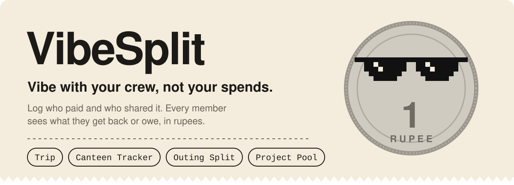

<p align="center">
  
</p>

<p align="center">
  <a href="https://https-shubhamsahu.github.io/VibeSplit/"><b>Open the live app</b></a>
  &nbsp;·&nbsp;
  <a href="#how-the-balance-sheet-works">How balances work</a>
  &nbsp;·&nbsp;
  <a href="#run-it-locally">Run it locally</a>
</p>

I made VibeSplit in the TSEC canteen, for the moment one person pays for the whole table. You make a group, add your friends and log each expense: who paid, who shared it. The balance sheet then tells everyone, in rupees, whether they get money back or owe it.

Want to try it without an account? Hit **Sneak Peek** on the home screen and everything stays in your browser.

## How the balance sheet works

<p align="center">
  
</p>

`src/trip/BalanceSheet.js` keeps one running number per member. That's the whole engine. For each expense the payer is credited the full amount, and everyone ticked under "Split between" is debited an equal share:

```js
balances[paidBy] += amount;
sharedBy.forEach(memberId => {
  balances[memberId] -= amount / sharedBy.length;
});
```

A positive balance reads "Gets back ₹X". Anything else reads "Owes ₹X". A few things fall out of that rule:

- Tick nobody under "Split between" and `ExpenseForm.js` splits it across the whole group.
- If you're left out of a split, you're never charged for it. Dev skipped the chai, so his balance only moves on the vada pav and the cold coffee.
- Each expense credits exactly what it debits. So the balances always sum to zero: 20 − 40 + 100 − 80 = 0 in the example.

It stops there, at each person's net. It doesn't yet turn those balances into a who-pays-whom list.

## Two ways in

|  | Sneak Peek | Join the Squad |
|---|---|---|
| Sign-in | None | Google |
| Where data lives | This browser's `localStorage` | Firestore: `trips`, `canteens`, `outings` or `projects` |
| Sharing | Not available | 6-character join code and a `#/join/<type>/<code>` link |
| History | Groups made on this device | Groups saved to your account in `trip_history` |

Open a join link while signed in and you're added to the shared group. Signed out, the group is copied to your device with you as "Guest User", and anything you log there stays on that device.

All four group types (Trip, Canteen Tracker, Outing Split, Project Pool) use the same screens and the same balance rule. Only the labels, the emoji choices and the Firestore collection change.

| Layer | Used for |
|---|---|
| React 18, React Router 6 (`HashRouter`) | Screens and routes, so deep links work on GitHub Pages |
| Firebase Auth + Firestore | Google sign-in, shared groups, history, analytics events |
| `localStorage` | Sneak Peek groups and guest copies of joined groups |
| React Context | Light/dark theme and toast messages |
| `gh-pages` | Publishing `build/` to GitHub Pages |

## Run it locally

Needs Node.js 18 or newer.

```bash
git clone https://github.com/https-shubhamsahu/VibeSplit.git
cd VibeSplit
npm install
npm start          # http://localhost:3000
```

`src/firebase.js` ships with the config for my `vibesplit-0011` Firebase project. Want your own? Replace the `firebaseConfig` values, turn on Google sign-in under Authentication and create a Firestore database.

Build and publish:

```bash
npm run build      # production bundle in build/
npm run deploy     # builds again, then publishes build/ to GitHub Pages
```

The app also logs usage analytics (page views, group actions, errors) to Firestore. [ADMIN_ANALYTICS_GUIDE.md](ADMIN_ANALYTICS_GUIDE.md) lists the collections and how to read them.

<details>
<summary><b>Project structure</b></summary>

```
src/
├── App.js                  # Router, theme and toast providers
├── Home.js                 # Landing page: Join the Squad / Sneak Peek
├── Dashboard.js            # Google sign-in and the four group types
├── firebase.js             # Firebase app, Auth and Firestore setup
├── About.js, JoinTrip.js   # Older versions, not routed
├── components/
│   ├── AboutPage.js        # "Who Made This?" page
│   ├── UserHistory.js      # Past groups and totals
│   ├── ThemeToggle.js
│   ├── Toast.js
│   ├── ErrorBoundary.js
│   └── LoadingSpinner.js
├── contexts/
│   ├── ThemeContext.js
│   └── ToastContext.js
├── services/
│   ├── authService.js
│   ├── analyticsService.js
│   ├── historyService.js
│   └── tripHistoryService.js
└── trip/
    ├── TripForm.js         # Create a group of any type
    ├── TripScreen.js       # Group page: members, expenses, balances
    ├── AddMember.js
    ├── MemberList.js
    ├── ExpenseForm.js      # Amount, note, who paid, split between
    ├── ExpenseList.js
    ├── BalanceSheet.js     # Net balance per member
    ├── ShareTrip.js        # Join code and share link
    └── JoinTrip.js         # Join from a share link
```

</details>

## Known gaps

- There's no who-pays-whom list yet. Balances stop at each member's net.
- Signed in, `ExpenseForm.js` writes every expense to the `trips` collection. Trip groups are fine. Canteen, outing and project groups live in their own collections, so adding an expense to one of them fails until that write uses the group's type.
- No tests yet, even though the React Testing Library packages are installed.

PRs for any of these are welcome.

## Author

Built by **Shubham Sahu**, Electronics and Computer Engineering at Thakur Shyamnarayan Engineering College, Mumbai.
[GitHub](https://github.com/https-shubhamsahu) · [shubhamsahu@nosus.foo](mailto:shubhamsahu@nosus.foo)
